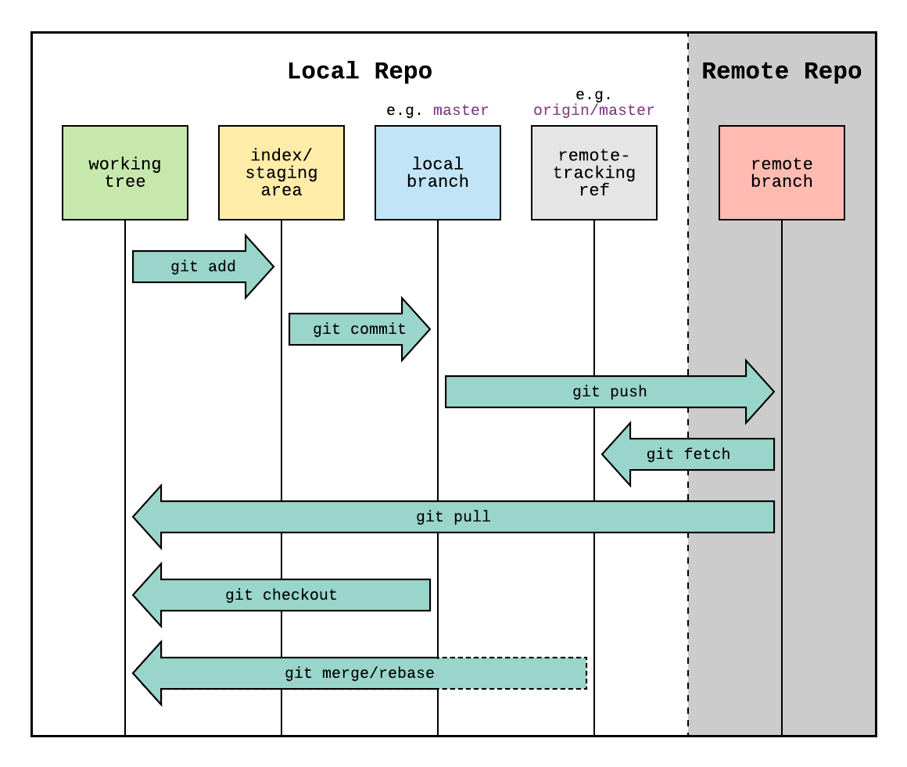

# Welcome to Git & Github!

This repo is created to learn **Git and GitHub**. After learning Git, here I'm practicing working with GitHub.

### ⚠️ IMPORTANT!

This README file is for understanding the Markdown language.

This repo **DOES NOT** contain any **CODE**. Its sole purpose is to **get hands dirty with version control**.

---

### Example Diagram

Diagram below shows the Git and Github workflow.



---

### Example List

- item
- another item
- last item
  - sub-item
  - another sub-item

---

### Example Numbered List

1. item 1
2. item 2
3. item 3
   1. sub-item 1
   2. sub-item 2

---

### Example Links

- [click here to go to github](https://www.github.com)
- <https://www.google.com>
- <tharindu3646@gmail.com>

---

### Example Blockquote

> this is a sample blockquote. it seems like markdown ain't that hard. blockquotes are a great way to format text, for example, showing important facts.

---

### Example Code Block

```python
#printing hello world in python
print('hello, world!')
```

---

### Example Inline Code

printing hello world in python be like `print('hello, world!')`

---

### Example Table

| Character      | Village | Role          |
| -------------- | ------- | ------------- |
| Naruto Uzumaki | Konoha  | Hokage        |
| Sasuke Uchiha  | Konoha  | Rogue Ninja   |
| Sakura Haruno  | Konoha  | Medical Ninja |
| Kakashi Hatake | Konoha  | Sensei        |
